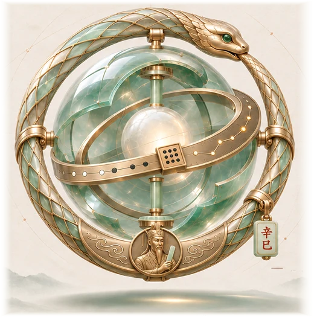

# PROJECT NOVA · DIY 工程实验室

**格物致知，造物有成。**

PROJECT NOVA 是一个面向工程实践和 DIY 的网站，用来记录项目设计、实施和验证过程，整理可复用的工程资料，并提供可以直接在浏览器里使用的计算工具。内容涵盖船舶电气、机械设计、AI 工程和工程工具。

[访问正式网站](https://www.token-xxo.cn/)

## 从哪里开始

| 入口 | 可以看什么 |
| --- | --- |
| [项目中心](https://www.token-xxo.cn/projects/) | NOVA 网站、玉衡主视觉、工程工具箱等项目的设计和进展。 |
| [工程知识库](https://www.token-xxo.cn/docs/) | 工程单位换算、计算记录和技术资料归档等方法。 |
| [工程工具箱](https://www.token-xxo.cn/tools/) | 在浏览器中使用工程计算工具，例如直流线路压降计算。 |
| [每日更新](https://www.token-xxo.cn/daily/) | 按日期浏览更新和历史归档。 |

## 首页主视觉「玉衡」

玉衡以青玉球体、衔尾蛇环和铜金测量环为主体。首页采用静态 WebP，浏览器根据显示尺寸选择合适的图片。三维模型和离线渲染过程另有记录，可从[玉衡项目页](https://www.token-xxo.cn/projects/yuheng-core/)或[渲染实验记录](docs/NOVA-YUHENG-20261110.md)开始阅读。



## 在本地运行

环境要求为 Node.js **22.23.4 或更高版本**，npm **9.6.5 或更高版本**。

```bash
git clone https://github.com/the-wrong-life/mute-bread-0781.git
cd mute-bread-0781
npm ci
npm run dev
```

访问终端中显示的本地地址。若要检查正式构建的效果，执行以下命令。

```bash
npm run build
npm run preview
```

`npm run build` 先运行 Astro 检查，再生成静态产物至 `dist/`。生产站由阿里云 ESA Pages 托管，构建分支为 `main`。

## 仓库结构

| 路径 | 内容 |
| --- | --- |
| `src/pages/` | 网站页面和路由。 |
| `src/data/` | 项目和每日更新等内容数据。 |
| `src/layouts/` · `src/components/` | 页面布局和可复用组件。 |
| `src/scripts/tools/` | 工程计算和对应的页面交互。 |
| `public/yuheng/` | 玉衡静态图片、模型和动画素材。 |
| [`tools/blender/`](tools/blender/README.md) | 玉衡离线渲染和素材打包脚本。 |
| `docs/` | 工程实验记录和[历史发布说明](docs/NOVA-RELEASE-20261111.md)。 |

网站使用 Astro、TypeScript 和 Three.js。玉衡三维模型、渲染图和着色器为本项目原创。

反馈问题时，请附上页面链接、复现步骤和实际结果。
